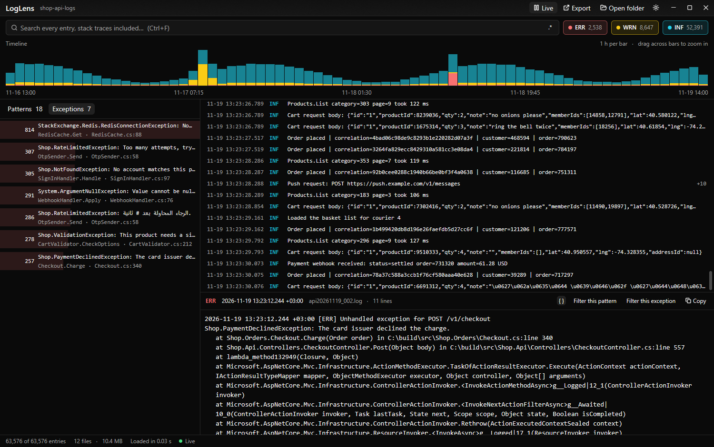
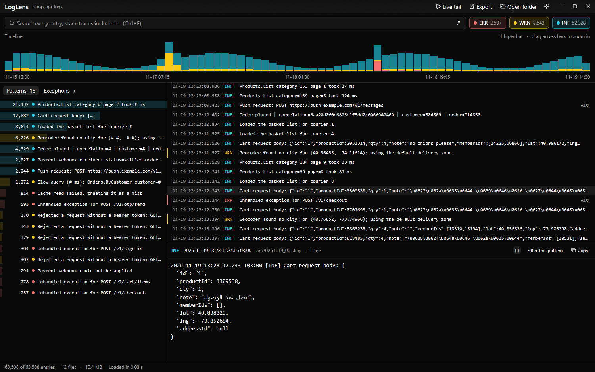

# LogLens

A fast desktop viewer and analyzer for Serilog text logs, written in Rust with [GPUI](https://www.gpui.rs).



Point it at a folder of logs. It reads every file, merges them into one timeline and shows what is
in there: which messages dominate, which exceptions are thrown from where, and when.

## What it does

- **Reads whole folders, fast.** Files are indexed in parallel and merged by timestamp, so the
  rolling files of several instances become one ordered list. On a 16-thread laptop CPU, a million
  entries (170 MB) load in about 0.2 s; changing a filter takes about 10 ms and a full-text search
  about 20 ms.
- **Timeline.** Entries per time bucket, split into errors, warnings and everything else. Drag
  across bars to zoom in, as many times as you like.
- **Patterns.** Messages are grouped by shape: numbers and ids collapse to `#`, JSON bodies to
  `{…}`. `Order placed | customer=1001 | order=700021` and its thousand siblings become one row
  with a count.
- **Exceptions.** Grouped by type, message and throw site, for example
  `Shop.NotFoundException: No account matches this phone number.` thrown at
  `SignInHandler.Handle · SignInHandler.cs:97`.
- **Filters that work together.** Level toggles, search, time range, pattern and exception narrow
  each other, and every count follows. Search covers the whole entry, stack trace included: plain
  text by default, a regular expression with the `.*` toggle.
- **Detail pane.** The full entry, with embedded JSON indented and `\uXXXX` escapes decoded. The
  `{ }` toggle shows the line as it was written.
- **Live tail.** Keeps reading the opened files and folders for appended entries and new files,
  and stays on the newest entries until you scroll away.
- **Export.** Saves the entries currently shown, as log text (which opens in LogLens again) or as
  a CSV table.
- Dark and light themes, keyboard navigation, right-to-left text.



## Log format

Serilog's default text output:

```text
2026-03-14 09:00:05.099 +02:00 [INF] Order placed | customer=1001 | order=700021
2026-03-14 09:00:06.442 +02:00 [ERR] Unhandled exception for POST /v1/sign-in
Shop.NotFoundException: No account matches this phone number.
   at Shop.Accounts.SignInHandler.Handle(SignInRequest request) in C:\build\src\Shop.Accounts\SignInHandler.cs:line 97
```

A line that does not start with a timestamp belongs to the entry above it. Files of any name or
extension are read; whatever is not a log of this shape is skipped.

## Build

Windows 10 or 11, x64. You need stable Rust and the MSVC build tools with a Windows SDK, which
GPUI uses to compile its shaders.

```powershell
cargo build --release
```

The result is `target\release\loglens.exe`: one file, nothing to install alongside it.

## Use

```powershell
loglens.exe C:\logs\my-api
```

Or start it and choose **Open folder**, or drop files and folders onto the window.

| Do this | To |
| --- | --- |
| `Ctrl+F` | jump to the search box |
| `↑` `↓` `PgUp` `PgDn` `Home` `End` | move through the entries |
| drag across the timeline | zoom into that time range |
| click a pattern or an exception | filter to it; click again to clear |
| **Live tail** | follow the logs as they are written |
| **Export** | save what is shown; name the file `.csv` to get a table |

### Try it on made-up logs

```powershell
python tools/sample_logs.py sample-logs
target\release\loglens.exe sample-logs
```

Add `--follow` to keep the script writing, then turn on **Live tail**.

## Limits

- Files are held in memory, so expect it to use about as much RAM as the logs are large.
- Tested on Windows only. GPUI also runs on macOS and Linux, but nothing here has been tried there.
- GPUI's Windows text layout does not reorder right-to-left text. LogLens corrects that for the
  text it displays, but what you type into the search box still looks mirrored. The search itself
  works.
- Live tail polls once a second.

## Development

```powershell
cargo test --release                  # parsing, grouping, filters, tail, export, JSON
cargo run --example make_icon         # rebuild assets/icon.ico from the two SVGs
$env:LOGLENS_DIR = "C:\logs\my-api"   # then time the whole pipeline on a real folder:
cargo test --release real_logs -- --ignored --nocapture
```

`src/logs.rs` holds everything that is not UI: parsing, grouping, filtering, tailing and export.
`src/app.rs` is the window. `tools/uitest.ps1` drives a running window by posting it messages, for
checking the UI without touching the mouse.
